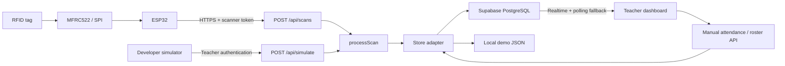

# Architecture and modification guide

## Boundaries

`lib/core.ts` owns UID normalization, school time, period selection, scan orchestration, present-only eligibility, and balanced shuffling. No framework imports are needed here. A scan is authenticated by its route before reaching the shared processor. The developer simulator validates a teacher session and then calls that exact processor.

`lib/server/store.ts` is the persistence adapter. Development uses a serialized, atomic-write local JSON file. Production uses PostgreSQL with teacher-scoped queries. The adapters share the processor and contracts; database-specific consistency is enforced inside PostgreSQL functions. `tests/database.test.ts` validates those functions with PostgreSQL in PGlite.

`write_attendance` and `replace_tag` use a teacher-scoped advisory transaction lock plus student locking. Initial roster rows are created atomically with the session. Composite foreign keys prevent mixing one teacher’s student and another teacher’s period. One `(period,date)` session and one `(session,student)` record are enforced independently with unique constraints.

Public browser access is read-only and constrained by RLS. Device token hashes cannot be selected by browser roles. Teacher writes go through authenticated, schema-validated routes; service-role operations carry a verified teacher ID. Security-definer RPCs are executable only by `service_role`, with an empty `search_path` and qualified table references. Don’t grant these RPCs directly to `authenticated`.

`proxy.ts` refreshes Supabase authentication cookies; teacher pages and APIs also validate the user using `getUser`. No production demo bypass exists. Teacher self-registration uses Supabase Auth and the teacher profile trigger. See the README for required Auth settings and redirect URLs.

## Interface structure

`app/[view]/page.tsx` validates the route and renders an authenticated shell. `components/classroom.tsx` supplies current state, period context, write helpers, subscriptions, and polling. `attendance.tsx`, `tools.tsx`, and the student/period/scanner/settings components own their respective workflows; `ui.tsx` holds shared presentation elements. Dates come from the school timezone, not the browser timezone.

Polling every 1.5 seconds also reconciles device health and catches missed subscriptions. Reads page through Supabase’s result limit so history does not silently stop at 1,000 records. This is intentionally straightforward for a capstone; a larger school should replace full snapshots with date-scoped queries, cursor-based history, and narrower subscriptions.

## Intended semantics

- Viewing a class does not change scanner routing. The Scanner page's **Attendance destination** persists a manual class override; **Follow class schedule** removes it. Overlapping active class times are allowed, and automatic routing chooses the lowest period number that is in session.
- Migration `008` stores reusable teacher-owned bell presets, Monday–Friday assignments, and a version counter. The app resolves school-local weekday and time through `lib/weekly-schedule.ts`. An unassigned weekday or an omitted period has no automatic scanner destination; a manual class override still works. Custom class times apply only on assigned days whose preset includes that period. The attendance RPC resolves the scanner destination again under the teacher lock before saving a tap, so a concurrent schedule edit cannot send attendance to the old class.
- Existing class times remain saved as fallback and for archived class display. Changing a preset does not rewrite prior attendance or reconstruct historical bell times.
- A session is created lazily when an active class is observed or first receives a change. Closed apps with no scans don’t create calendar-wide absence sessions.
- Initially enrolled students get absent records, preserving that day’s roster if membership later changes.
- A new student added during a session appears absent until changed/scanned; their saved record is created on that first attendance action.
- RFID preserves existing present/late records and the first timestamp. Manual attendance may overwrite a status. An RFID tap can change absent/excused back to present.
- Only `present`, not `late` or `excused`, participates in tools, exactly as requested. Change `presentStudents()` if the school wants late students included too.
- Group lists become stale if present membership changes; regenerate before copying/printing.
- Tag replacement deactivates the old tag. Old UIDs remain reserved to their original student; cross-student reassignment is deliberately not supported by the first version.
- History is based on saved session records. Inactive and removed students remain visible in past sessions.
- Enrollment is authenticated, per-scanner, and expires in 10 minutes. Enrollment scans never mark attendance.
- Scanner status is online for 60 seconds after the last received scan/heartbeat. It reflects server communication, not a guarantee the RFID reader itself is healthy.

## Extensions

For more classrooms, add device-to-room routing instead of the current teacher-level active period. Add a dedicated immutable scan-event table if auditing every tap is required. For durable offline replay, add event IDs, capture timestamps, time synchronization checks, persistent queue storage, and server-side routing by captured session before increasing the current short retry window.
